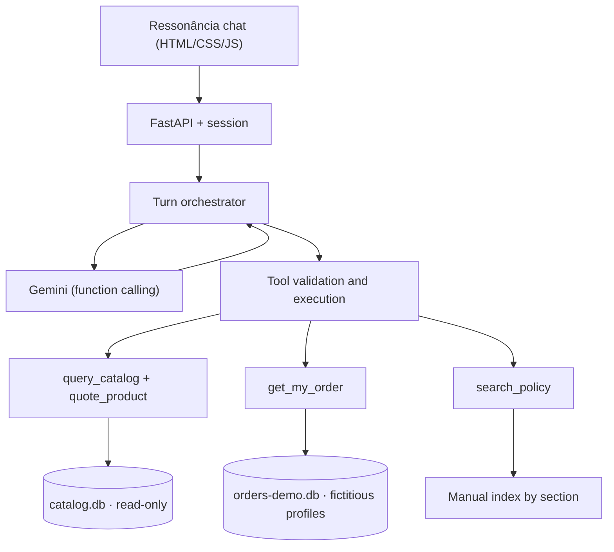

# Architecture

> The source technical contract is guide 02 (private, `_private_inputs/guides/02-backend/`). This document summarizes what is being built and where each part lives. Paths marked *(planned)* do not exist yet.

## Overview

A single FastAPI app serves the interface and the API on the same origin. Gemini decides which tool to call. The backend validates the call, runs it, enforces permissions and decides the values shown on screen.



## Components and responsibilities

| Module | Responsibility | What proves it works |
| --- | --- | --- |
| `scripts/import_snapshot.py` | Reads the 6 CSVs (UTF-8 with BOM) from the ZIP or a directory; validates headers, keys and references; builds `catalog.db` and `orders-demo.db` in a temporary directory and publishes them together; writes a manifest with hashes | Counts 9/65/25/50/20/22 and 61 sellable products match `oracles.json`; an invalid row stops the import with line and reason |
| `app/tools/quote.py` | List price, active promotion, PIX (5% only without a promotion), installments per §3/§3.1, `needs_confirmation` where §3 and §3.1 diverge | Oracles 95 (219900 → 208905) and 127 (32310 with or without PIX); R$ 600 in 12x is rejected |
| `app/tools/catalog.py` | Executor for model-written SELECTs with a deny-by-default `set_authorizer`, `query_only`, step and row limits; hydrates IDs from the canonical table | ATTACH, writes, PRAGMA, metadata, recursive CTEs and non-allowlisted functions are blocked |
| `app/tools/orders.py` *(planned)* | `WHERE order_id = ? AND customer_id = ?`, with the profile injected by the session | Profile A sees order 8; a cross-profile request gets the same answer as a non-existent order |
| `app/tools/policies.py` *(planned)* | Section-level retrieval (lexical first) with related sections (§3↔§6.2, §4.2↔§8) | Labeled evaluation with top-3 coverage recorded |
| `app/agent.py` *(planned)* | `generate_content` loop with manual dispatch, per-turn budget (3 rounds, 6 tools, 25 s) and response composition with hydrated values | Takamine GD20 → "e no PIX?" returns R$ 2.199,00 and then R$ 2.089,05 |
| `app/session.py` *(planned)* | In-memory session with an opaque cookie, 30-min TTL, `request_id` deduplication and a profile switch that clears context | 409/410 and profile-switch tests |
| `app/contracts.py` | Pydantic DTOs (`extra='forbid'`): `text`, `cards[]`, `sources[]`, `next_action`, `handoff` | Contract examples validate against the schema |
| `app/main.py` *(planned)* | Routes `/`, `/api/session`, `/api/demo-profiles`, `/api/session/profile`, `/api/chat`, `/healthz`, plus the public error envelope | HTTP tests without an API key |
| `app/static/` *(planned)* | Ressonância screen: single column, speech before cards, one avatar per turn, a single thumbnail, slogan only at the opening | Playwright at 320 px, 390 px and desktop |

## Planned tree

```text
app/
  main.py  contracts.py  config.py  session.py  agent.py
  tools/   catalog.py  quote.py  orders.py  policies.py
  static/  index.html  styles.css  app.js  img/catalogo-ressonancia.webp  fonts/
scripts/   import snapshot, build manual index, Gemini smoke test and benchmark, checks
data/      generated demo artifacts (data/build/ is ignored by Git)
tests/     domain, tools, HTTP; optional real-integration tests, clearly marked
evals/     labeled questions, model benchmark and retrieval results
examples/  3–5 conversations captured from the final version
Dockerfile
```

## Where the structure differs from the `software-build` skill

The skill suggests `PROGRESS.md` at the repository root. Here it lives in `docs/` with the roadmap, journal, errors and decisions, so the public root holds only the README, the primer and configuration. The primer (`CLAUDE.md`) stays at the root because Claude Code loads it from there. There is no other behavioral difference from guide 02.

## Public versus private

| Public (Git) | Private (`_private_inputs/`, ignored) |
| --- | --- |
| Code, tests, documentation, reviewed real conversations | Original ZIPs, PDFs, raw CSVs, guides 01/02/03, mockup |
| `.env.example` without values | `.env` with the key |
| Reference values (`tests/fixtures/oracles.json`, IDs and numbers only) | Databases and manual index derived from the challenge data |
