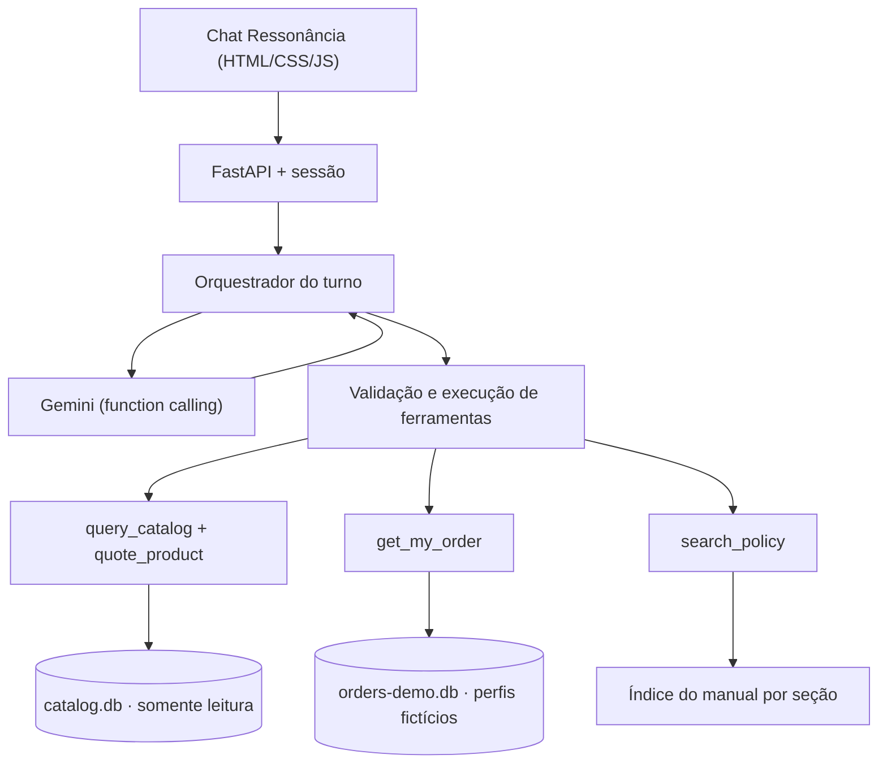

# Arquitetura

> O contrato técnico de origem é o guia 02 (privado, `_insumos_privados/guias/02-backend/`). Este documento resume o que será construído e onde cada parte vai morar. Os caminhos de código são **alvos**: ainda não existem.

## Visão geral

Uma única aplicação FastAPI serve a interface e a API na mesma origem. O Gemini decide qual ferramenta pedir. O backend valida a chamada, executa, aplica as permissões e define os valores que aparecem na tela.



## Componentes e responsabilidades

| Módulo (alvo) | Responsabilidade | O que prova que funciona |
| --- | --- | --- |
| `scripts/import_snapshot.py` | Lê os 6 CSVs (UTF-8 com BOM) e valida cabeçalhos, chaves e vínculos. Gera `catalog.db` e `orders-demo.db` num diretório temporário e só publica os dois juntos. Grava um manifesto com hashes | As contagens 9/65/25/50/20/22 e os 61 produtos vendáveis batem com `oraculos.json`. Uma linha inválida interrompe a importação indicando linha e motivo |
| `app/tools/quote.py` | Preço de tabela, promoção ativa, PIX (5% só sem promoção), parcelas pelas regras do §3/§3.1 e `needs_confirmation` onde §3 e §3.1 divergem | Os oráculos 95 (219900 → 208905) e 127 (32310 com ou sem PIX). R$ 600 em 12x é recusado |
| `app/tools/catalog.py` | Executor de SELECT gerado pelo modelo com `set_authorizer` de negação por padrão, `query_only`, limite de passos e de linhas. Hidrata os IDs a partir da fonte canônica | Tentativas de ATTACH, escrita, PRAGMA, metadados e leitura de pedidos são bloqueadas |
| `app/tools/orders.py` | `WHERE order_id = ? AND customer_id = ?`, com o perfil injetado pela sessão | O perfil A vê o pedido 8. Um perfil cruzado recebe a mesma resposta de um pedido inexistente |
| `app/tools/policies.py` | Busca por seção (lexical primeiro) com seções relacionadas (§3↔§6.2, §4.2↔§8) | Avaliação rotulada com cobertura top-3 registrada |
| `app/agent.py` | Loop do `generate_content` com despacho manual, orçamento por turno (3 rodadas, 6 ferramentas, 25 s) e composição da resposta com valores hidratados | A sequência Takamine GD20 → "e no PIX?" retorna R$ 2.199,00 e depois R$ 2.089,05 |
| `app/session.py` | Sessão em RAM com cookie opaco, TTL de 30 min, deduplicação por `request_id` e troca de perfil que limpa o contexto | Testes de 409/410 e de troca de perfil |
| `app/contracts.py` | DTOs Pydantic (`extra='forbid'`): `text`, `cards[]`, `sources[]`, `next_action` e `handoff` | Exemplos de `turnos.json` validam contra o schema |
| `app/main.py` | Rotas `/`, `/api/session`, `/api/demo-profiles`, `/api/session/profile`, `/api/chat` e `/healthz`, com o envelope de erros públicos | Testes HTTP sem chave |
| `app/static/` | Tela Ressonância: coluna única, fala antes dos cards, um avatar por turno, miniatura única e slogan só na abertura | Playwright em 320 px, 390 px e desktop |

## Árvore planejada

```text
app/
  main.py  contracts.py  session.py  agent.py
  tools/   catalog.py  quote.py  orders.py  policies.py
  static/  index.html  styles.css  app.js  img/catalogo-ressonancia.webp  fonts/
scripts/   importar snapshot, extrair seções do manual, smoke e benchmark Gemini
data/      artefatos de demo gerados + manifesto (bancos ignorados pelo Git)
tests/     domínio, ferramentas, HTTP; integração real opcional e marcada
evals/     perguntas rotuladas, resultados do benchmark de modelos e da busca
examples/  3–5 conversas capturadas da versão final
Dockerfile
```

## Onde a estrutura difere da skill `software-build`

A skill sugere `PROGRESSO.md` na raiz. Aqui ele fica em `docs/`, junto com roadmap, diário, erros e decisões, para que a raiz pública tenha só README, primer e configuração. O primer (`CLAUDE.md`) fica na raiz porque o Claude Code o carrega de lá. Não há outra divergência de comportamento em relação ao guia 02.

## Separação entre o que é público e o que é privado

| Público (Git) | Privado (`_insumos_privados/`, ignorado) |
| --- | --- |
| Código, testes, documentação, conversas reais revisadas | ZIPs originais, PDFs, CSVs brutos, guias 01/02/03, mockup |
| `.env.example` sem valores | `.env` com a chave |
| Manifesto com hashes e contagens | Bancos derivados com dados de clientes |
